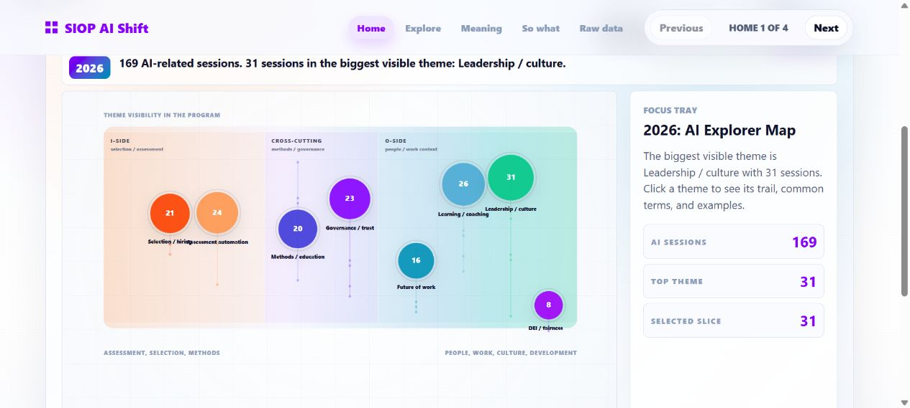

# SIOP Conference Data Visualization

How has AI-related discussion changed across SIOP conference programs?

This project looks at public session information from the Society for Industrial and Organizational Psychology's 2022–2026 conferences. It combines data collection and cleaning with an interactive view of where AI appears, the topics around it, and the session examples behind the patterns.

**[Open the interactive visualization](https://tristowww.github.io/siop-conference-data-viz/)** · [Explore the saved data](app/data/siop_ai_story.json) · [Data workflow and build notes](docs/DEVELOPMENT.md)

[](https://tristowww.github.io/siop-conference-data-viz/)

## A quick read of the saved results

The collected dataset contains **3,444 session records across five years**. Two patterns in the saved analysis:

- **AI-related sessions make up a larger share in 2026 than in 2022:** 169 of 552 records (30.6%), compared with 90 of 729 (12.3%). This flag uses titles, descriptions, tracks, and formats.
- **The narrower AI visibility measure also increases:** from 37 of 729 records (5.1%) in 2022 to 113 of 552 (20.5%) in 2026. This measure uses titles, tracks, and formats, leaving out descriptions.

Both measures use all collected session records for the same year as the denominator. Counts and definitions are in the [saved analysis](app/data/siop_ai_story.json); the [analysis script](scripts/build_ai_story_dataset.py) records how the flags and summaries are built.

The source material differs by year, from archived-program OCR to newer workbook and agenda records. Coverage and text detail affect what can be detected. These are descriptive comparisons of the collected records, rather than estimates of the full conference program or evidence of workplace AI adoption.

## Explore the analysis

Start with the year controls, then select a theme to see its terms and session examples. The I-side lens focuses on selection and assessment; the O-side lens focuses on people and organizational contexts. The theme groups use TF-IDF similarity to seed themes and are exploratory.

The [processed session table](data/processed/siop_ai_story_sessions.csv) supports closer inspection. Author parsing is incomplete, and talk-level browsing remains disabled while missing authors are reviewed. The [missing-author table](data/processed/siop_ai_missing_authors.csv) records that work.

## Preview locally

The visualization is a static HTML/CSS/JavaScript app with bundled analysis data. It loads D3 from a public CDN, so the interactive charts need an internet connection.

```bash
python -m http.server 8000 --directory app
```

Open `http://localhost:8000`. Previewing the app does not collect new data or rerun the analysis.

## Methods and development

- [Data workflow and development notes](docs/DEVELOPMENT.md): existing source history, processing steps, and build commands.
- [HTML editing guide](docs/html-editing-guide.md): locations for copy, charts, and styling.
- [Scraping plan](docs/scraping-plan.md): source-collection approach and access limits.

This is an independent exploratory project using public conference-program information.
